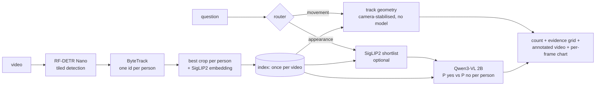

# CrowdLens

**Live demo:** https://crowdlens.streamlit.app/ (demo-only: 3 pre-indexed clips, no uploads) · **Code:** https://github.com/agentsc07/crowdlens

> Ask a crowd video a plain-English question ("how many people are wearing a red top?") and get a count plus a thumbnail of every person it counted. Fully local, open models, attributes only, never identities.

## The problem
Counting people with a given attribute in video means watching it by hand, or training a classifier per attribute. Neither works for a question asked on the spot.

## How it works

1. **Index once** (`crowdlens/index.py`): detect on every Nth frame, track, keep each person's sharpest crop, estimate camera motion.
2. **Ask many times** (`score.py`, `vlm.py`): Qwen3-VL-2B reads P(Yes) against P(No) from one forward pass per crop. Answers are cached per question.
3. **Search-then-verify** (`search.py`, optional): SigLIP2 ranks crops against the question text; only the top share goes to the VLM.
4. **Movement questions** ("moving right", "standing still") come from track geometry in camera-stabilised coordinates, with no model call.

## Results
**Claude-labelled, human audit pending.** 164 people from 4 public MOT17 clips (15 s each) x 8 questions, labelled by Claude from crops; a 30-person human audit (`eval/audit_app.py`) is still to be done, and these numbers will be re-run after it. Only 9 to 25 people are positive per question, so per-question scores are noisy; read the pooled rows.

| | precision | recall | F1 | mean count error |
|---|---|---|---|---|
| VLM, threshold 0.5 | 0.48 | 0.96 | 0.64 | 111 % |
| VLM, threshold 0.9 (chosen on clips 02/04/09) | 0.70 | 0.85 | **0.76** | **34 %** |

- Held-out clip 11 (a mall, different camera): pooled F1 0.86 at 0.9, 0.78 at 0.5.
- **The original goal of count error under 10 % is not met.** Per-question count error at 0.9 ranges from 10 % (hat or cap) and 20 to 25 % (bags, backpack, shorts, black jacket) up to 45 % (white shirt, shopping bag) and 80 % (red top).
- Tracking: tracks vs true pedestrians (MOT17 ground truth) is 0.94 to 1.41 per clip (mean 1.24): people are over-counted by about a quarter because tracks fragment.

### Search-then-verify, the project's main claim
| shortlist | recall of true matches | F1 | VLM calls per question | relative time |
|---|---|---|---|---|
| top 20 % | 0.70 | 0.72 | 24 | ~0.2x |
| top 30 % | 0.82 | 0.74 | 37 | ~0.3x |
| top 50 % | 0.94 | 0.77 | 62 | ~0.5x |
| top 75 % | 0.98 | 0.77 | 92 | ~0.75x |
| verify everyone | 1.00 | 0.76 | 123 | 1x |

Top 50 % matches verify-everyone accuracy at half the VLM calls (about 2x faster per question on this machine; measured seconds are noisy because the laptop was memory-starved, the call ratio is the robust number). The hoped-for "over 95 % recall at a large saving" is **not reached** with SigLIP2-base: it ranks "shopping bag" (AP 0.23) and "black jacket" (0.55) poorly. Full tables: `eval/results.md`.

**Speed.** Indexing a 15 s 1080p clip takes about 20 s on an Apple-silicon laptop. A question over ~160 people takes roughly 40 to 120 s verifying everyone (0.26 to 0.7 s per person depending on machine load). The free-CPU hosted demo is slower; its CPU timing is **not yet measured** (my laptop was swapping when I tried), so sample questions are pre-answered.

## Hosted demo vs the full app
Free hosting could not run the full app (Hugging Face now charges for Docker Spaces; free Streamlit Cloud has 1 GB of RAM), so the hosted demo is deliberately small:
- **Preset questions** show the fully verified Qwen3-VL answers, computed offline on the 3 pre-indexed MOT17 clips.
- **Any other question** gets a **quick answer, labelled unverified**: a NumPy port of the SigLIP2 text encoder (no torch; 259 MB of int8/fp16 weights, memory-mapped) ranks the stored person crops against your words. Peak RAM measured at 655 MB. The encoder matches the PyTorch text tower at cosine 0.9997 on English queries (non-Latin text is not supported).
- **How good is the quick count?** Weak, and the demo says so: SigLIP2's own probabilities summed over people give 90 % mean count error; the rule used (similarity above mean + 1.25 sd) gets 26 % but mostly predicts "about a tenth of people", whatever you ask. Ranking is the useful part (see `eval/quick_count.md`).
- Uploads and full verification run locally (app or CLI). `Dockerfile` and `deploy/push_space.sh` remain for anyone with a paid Space.

## Privacy
CrowdLens counts attributes, never identities. No face recognition, no "find this person", no linking people across videos. Track numbers are temporary ids that exist inside one video's index only. Sample footage is the public MOT17 benchmark.

## Run it
```bash
git clone https://github.com/agentsc07/crowdlens && cd crowdlens && pip install -e .   # gives the `crowdlens` command
crowdlens index video.mp4
crowdlens ask video.mp4 "wearing a red shirt?"          # add --search 0.5 for search-then-verify
python -m streamlit run crowdlens/app.py                # the web app
```
See `startup.md` for setup details. Tests: `pytest` (12 pass). Reproduce the evaluation: `eval/fetch_mot17.py`, `eval/build_set.py`, `eval/run_eval.py`, `eval/metrics.py`.

## Limits
Closed-set detector (COCO classes), partial and distant people are judged "too small" under 64 px, lighting shifts colours, the router is regex-based (typos and mixed movement-plus-appearance questions fail), movement thresholds are unvalidated, not meant for dense stampede-scale crowds.

## Credits
Sample clips: MOT17 (Milan, Leal-Taixé, Reid, Roth, Schindler, 2016), CC BY-NC-SA 3.0, non-commercial use. Models: RF-DETR, Qwen3-VL-2B-Instruct, SigLIP 2, ByteTrack via supervision. Code: MIT.
